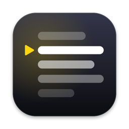

# Prompter

A small native teleprompter for macOS. It floats above your other windows, sits right under the camera, and can follow your voice instead of scrolling at a fixed speed.

- **Voice following** – listens through the mic and keeps the word you're saying on the reading line. It waits when you pause and catches up if you skip ahead. Uses Apple's speech recognition, on-device where the language supports it.
- **Fixed speed** – or scroll at a steady pace, set in lines per minute.
- **Hidden from screen sharing** – asks macOS to leave the window out of screen shares and recordings. Some capture tools ignore this, so test with yours first.
- **Works from other apps** – global shortcuts let you drive it while Zoom or Meet is in front.

## Install

**Quickest:** paste this into Terminal. It downloads the latest release, puts `Prompter.app` in your Applications folder and opens it.

```sh
curl -fsSL https://raw.githubusercontent.com/deniurchak/prompter/main/install.sh | bash
```

**Or by hand:**

1. Download `Prompter.zip` from the [latest release](https://github.com/deniurchak/prompter/releases/latest) and unzip it.
2. Drag `Prompter.app` into your Applications folder and open it.
3. macOS will refuse the first time, because the app isn't notarized by Apple. Open **System Settings → Privacy & Security**, scroll down to the message about Prompter, and click **Open Anyway**. This is only needed once.

Runs on macOS 13 or later, on both Apple silicon and Intel Macs.

## Build

Requires macOS 13+ and the Xcode command line tools.

```sh
./build.sh
```

This compiles `main.swift`, creates `Prompter.app` next to the script, and copies it to `/Applications`.

## Shortcuts

| Key | Action |
| --- | --- |
| `Space` | Play / pause |
| `↑` `↓` | Slower / faster |
| `←` `→` | Jump back / forward |
| `R` | Back to top |
| `E` or `⌫` | Edit the script (`Esc` to finish) |
| `⌘V` | Replace the script with the clipboard |
| `⌘O` | Open a text file |
| `⌘+` `⌘−` | Text size |

Hold `⌃⌥` with `Space`, the arrows or `R` to control Prompter while another app is in front.

Voice following needs Microphone and Speech Recognition access; macOS asks the first time you turn it on.
